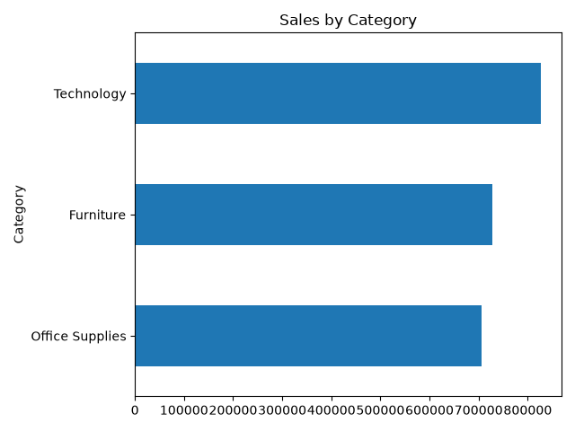
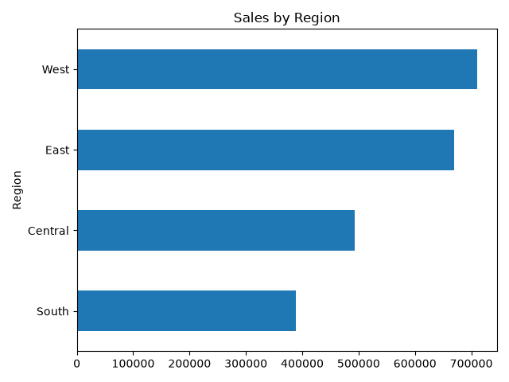
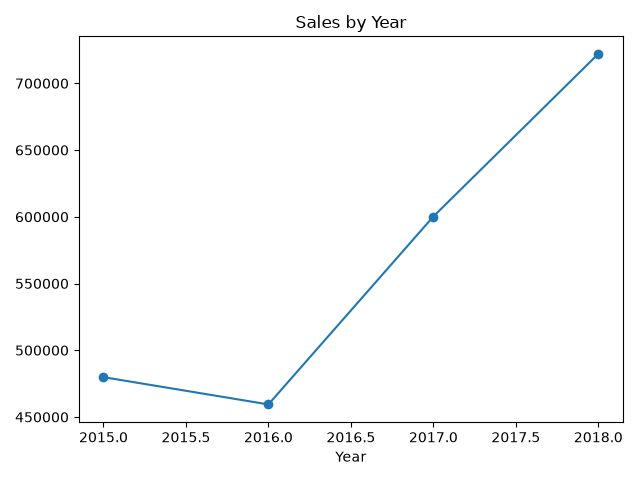
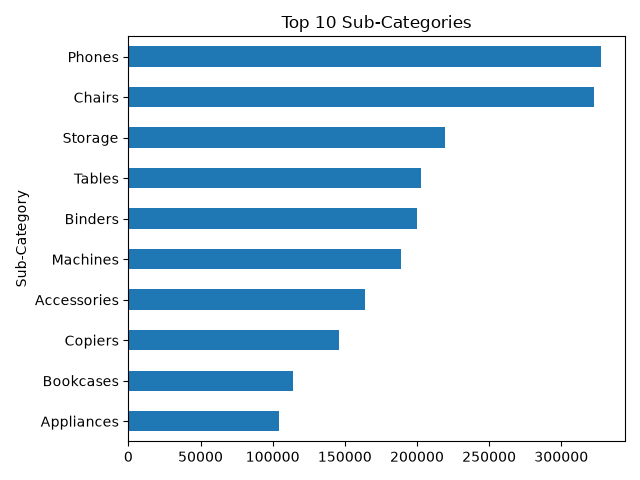

# Superstore Sales Analysis

Analysis of retail sales data (2015-2018) using Python to identify top-performing categories, regions, and products.

## Tools
Python, Pandas, Matplotlib

## What I did
- Cleaned the data (removed duplicates, converted dates)
- Analyzed sales by category, region, year, and sub-category
- Created 4 charts to visualize the results

## Key findings
- Technology is the top-selling category
- The West region has the highest sales
- 2018 was the best year
- Phones is the top-selling sub-category

## Charts

